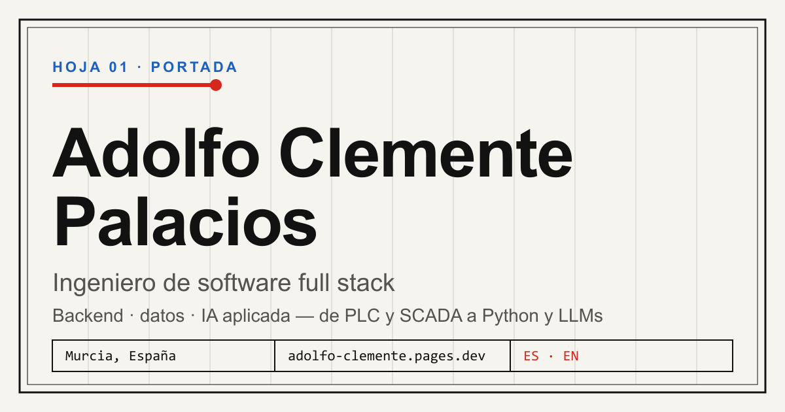
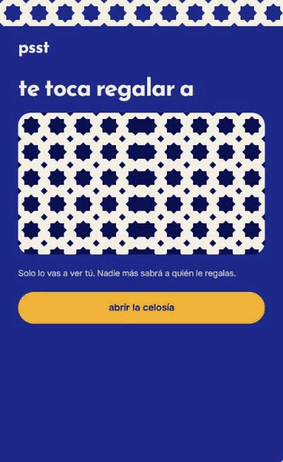
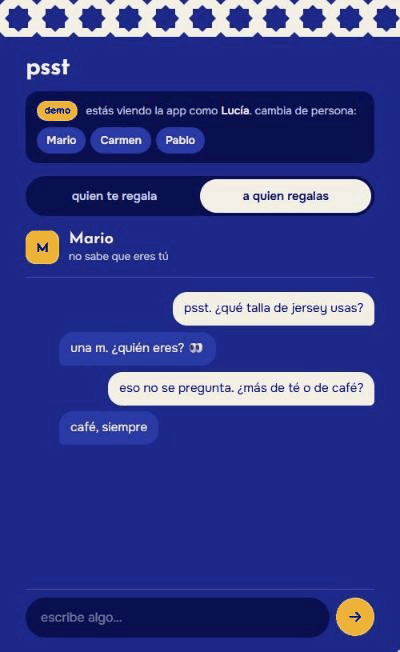
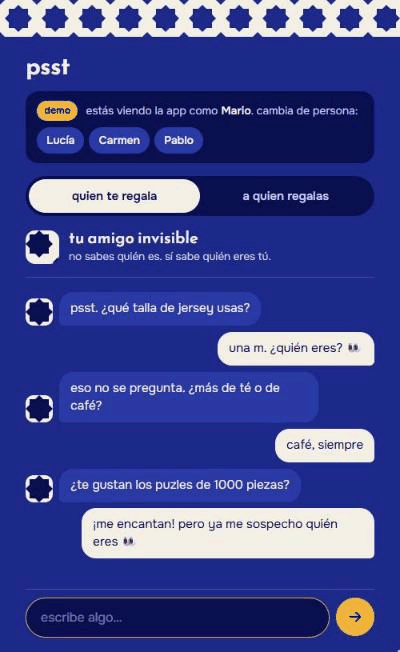

<picture>
  <source media="(prefers-color-scheme: dark)" srcset="./assets/header-dark.svg" />
  <source media="(prefers-color-scheme: light)" srcset="./assets/header-light.svg" />
  
</picture>

  
  
  
  

## Sobre mí

Casi cuatro años construyendo aplicaciones web: backend en **Python y Node**, bases de datos, colas de tareas y servidores. Vengo de la **ingeniería electrónica industrial y la automatización**, así que pienso en sistemas: señales que entran, procesos que no se caen, datos que llegan a tiempo. Uso la IA a diario para desarrollar (Claude, Codex, OpenCode) y también la meto en producto.

Me importa que las cosas **se entiendan sin manual** y que el código **se pueda explicar en una frase**.

- 📍 Murcia, España · ES nativo, EN B1–B2.
- 🌐 Mi web: **[adolfo-clemente.pages.dev](https://adolfo-clemente.pages.dev)**, mi trayectoria dibujada como un juego de planos eléctricos.
- 📄 [Descargar mi CV](https://adolfo-clemente.pages.dev/cv/AdolfoClementePalacios_CV_2026.pdf) (PDF).
- 🌱 Ahora mismo: IA aplicada (RAG y LLMs), tiempo real con websockets y PWAs que se sienten nativas.

## Experiencia

| Cuándo | Dónde | Qué hice |
| --- | --- | --- |
| 2023 — 2025 · 2026 — hoy | **Logiticket Events** Full Stack · Responsable técnico | Responsable técnico del producto: arquitectura y decisiones de diseño. Plataforma de venta, CRM para organizadores (desde cero) y ERP administrativo. Reescritura de consultas críticas e indexación en PostgreSQL: **hasta un 97 % menos de tiempo de consulta**. Diseño del esquema de datos, administración del servidor y despliegues en producción. |
| Oct 2025 — Nov 2026 | **Phicus Tecnología** Ingeniero de Software Full Stack | Backend en Django con MySQL, MongoDB y Redis; tareas asíncronas con Celery y RabbitMQ. Migración de frontends de Vue 2 a Vue 3. Diseño y desarrollo de un **chatbot RAG** de soporte a clientes (FastAPI, Qdrant, modelo local o LLM por API). |
| Dic 2022 — Sep 2023 | **Grupo Oesía** Desarrollador de Software | Aplicaciones con Angular, Express y NestJS; Git y SQL a diario. |
| Ene — Jun 2022 | **AM Soluciones Automatización** Programador de autómatas, HMI y SCADA | Programación de PLC, pantallas HMI y sistemas SCADA. |
| Mar — Jun 2021 | **Binarii Automation Engineering** Ingeniero de Automatización | Primer contacto con la industria: ingeniería de automatización. |

**Formación:** Máster en Automatización Industrial (INESEM Business School, 2021–2022) · Grado en Ingeniería Electrónica Industrial y Automática (Universidad Politécnica de Cartagena, 2016–2021).

## Mi portafolio

  Mi trayectoria, mis proyectos y mi stack leídos como un <b>juego de planos eléctricos</b>: esquema de experiencia, 
  regletero de proyectos y lista de materiales. Bilingüe (ES/EN) y con el CV para descargar. 
  Astro · CSS a mano · Cloudflare Pages

  

## Con qué trabajo

  <picture>
    <source media="(prefers-color-scheme: light)" srcset="https://skillicons.dev/icons?i=ts,react,nextjs,vue,astro,vite,css&theme=light" />
    
  </picture>
   
  <picture>
    <source media="(prefers-color-scheme: light)" srcset="https://skillicons.dev/icons?i=nodejs,nestjs,python,django,fastapi,postgres,mysql,mongodb,redis,rabbitmq&theme=light" />
    
  </picture>
   
  <picture>
    <source media="(prefers-color-scheme: light)" srcset="https://skillicons.dev/icons?i=docker,git,github,githubactions,vercel,figma&theme=light" />
    
  </picture>

## Proyectos destacados

<!-- OCULTO-LDV

<h3 align="center"><a href="https://github.com/aadolfo8/linea-de-vida">✦ Línea de vida</a></h3>

  Las fotos de la familia, repartidas por carpetas de Drive, ordenadas por fecha y convertidas en 
  una cronología que se recorre como un <b>cielo nocturno</b>: los años son constelaciones, los meses estrellas. 
  solo lectura · solo las carpetas que eliges · sin IA

  
  
   
  Next.js · React · NestJS · PostgreSQL + Prisma · Redis + BullMQ · Docker

 
-->

<h3 align="center"><a href="https://github.com/aadolfo8/psst">✦ psst</a></h3>

  Amigo invisible sin cuentas, con un <b>chat anónimo</b> entre quien regala y quien recibe 
  para acertar con el regalo sin desvelar quién eres. 
  sin cuentas · sin email · un enlace por WhatsApp, un nombre y un PIN

<table>
  <tr>
    <td align="center" width="33%">
       
      abres la celosía y ves a quién le regalas
    </td>
    <td align="center" width="33%">
       
      el mismo chat visto desde los dos lados
    </td>
    <td align="center" width="33%">
       
      al final se descubre quién acertó
    </td>
  </tr>
</table>

  
  
   
  FastAPI · PostgreSQL · websockets · React · Vite · PWA con push

## Otros proyectos

<table>
  <tr>
    <td width="33%" valign="top">
      <h4><a href="https://github.com/aadolfo8/portafolio-carmen">✦ portafolio-carmen</a></h4>
      
Portafolio para una profesional creativa: una web que pone su trabajo por delante y se carga rápido en el móvil.

      
TypeScript · diseño web

    </td>
    <td width="33%" valign="top">
      <h4><a href="https://github.com/aadolfo8/corpo-wellness-studio">✦ corpo-wellness-studio</a></h4>
      
Colección de propuestas web para una clínica: varias direcciones visuales para un mismo cliente.

      
TypeScript · diseño web

    </td>
    <td width="33%" valign="top">
      <h4><a href="https://github.com/aadolfo8/galaxy-weather-react">✦ galaxy-weather</a></h4>
      
Prueba técnica de una app del tiempo, hecha dos veces: en <a href="https://github.com/aadolfo8/galaxy-weather-react">React</a> y en <a href="https://github.com/aadolfo8/galaxy-weather-vue">Vue</a>.

      
TypeScript · React · Vue

    </td>
  </tr>
  <tr>
    <td width="33%" valign="top">
      <h4><a href="https://github.com/aadolfo8/lag-switch">✦ lag-switch</a></h4>
      
Duelo 1v1 cenital en el navegador donde las armas son todo lo que sale mal al jugar online: servidor autoritativo, predicción en cliente y compensación de lag.

      
TypeScript · websockets · juego multijugador

    </td>
  </tr>
</table>

## Actividad

  

<!--
## Sonando ahora

  

-->

hecho a mano en Murcia ✦

