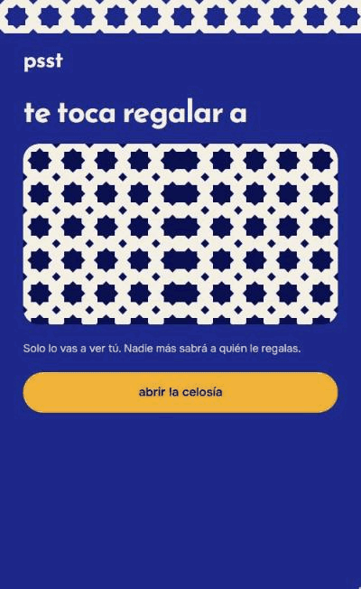
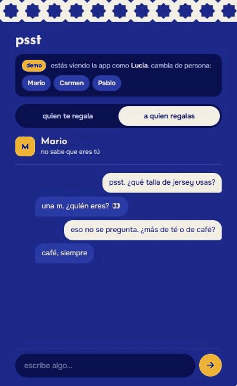
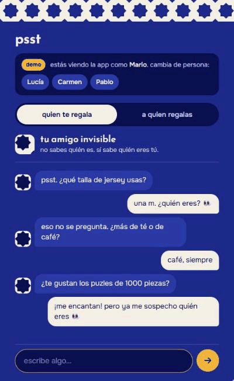

<picture>
  <source media="(prefers-color-scheme: dark)" srcset="./assets/header-dark.svg" />
  <source media="(prefers-color-scheme: light)" srcset="./assets/header-light.svg" />
  
</picture>

  
  
  

## Sobre mí

Construyo productos web de principio a fin: la interfaz que tocas, la API que hay detrás y los datos que lo sostienen. Me importa que las cosas **se entiendan sin manual** y que el código **se pueda explicar en una frase**.

- 💼 Ahora: desarrollador front-end en **Phicus Tecnología**.
- 🧳 Antes: desarrollador full-stack en **Logiticket**.
- 🔧 Vengo de la **Ingeniería Electrónica Industrial y Automática**: pienso en sistemas, no solo en pantallas.
- 🌱 Aprendiendo: Python con FastAPI, tiempo real con websockets y PWAs que se sienten nativas.

## Con qué trabajo

  <picture>
    <source media="(prefers-color-scheme: light)" srcset="https://skillicons.dev/icons?i=ts,react,nextjs,vue,vite,css&theme=light" />
    
  </picture>
   
  <picture>
    <source media="(prefers-color-scheme: light)" srcset="https://skillicons.dev/icons?i=nodejs,nestjs,python,fastapi,postgres,prisma&theme=light" />
    
  </picture>
   
  <picture>
    <source media="(prefers-color-scheme: light)" srcset="https://skillicons.dev/icons?i=docker,git,github,githubactions,vercel,figma&theme=light" />
    
  </picture>

## Proyectos destacados

<h3 align="center"><a href="https://github.com/aadolfo8/linea-de-vida">✦ Línea de vida</a></h3>

  Las fotos de la familia, repartidas por carpetas de Drive, ordenadas por fecha y convertidas en 
  una cronología que se recorre como un <b>cielo nocturno</b>: los años son constelaciones, los meses estrellas. 
  solo lectura · solo las carpetas que eliges · sin IA

  
  
   
  Next.js · React · NestJS · PostgreSQL + Prisma · Redis + BullMQ · Docker

 

<h3 align="center"><a href="https://github.com/aadolfo8/psst">✦ psst</a></h3>

  Amigo invisible sin cuentas, con un <b>chat anónimo</b> entre quien regala y quien recibe 
  para acertar con el regalo sin desvelar quién eres. 
  sin cuentas · sin email · un enlace por WhatsApp, un nombre y un PIN

<table>
  <tr>
    <td align="center" width="33%">
       
      abres la celosía y ves a quién le regalas
    </td>
    <td align="center" width="33%">
       
      el mismo chat visto desde los dos lados
    </td>
    <td align="center" width="33%">
       
      al final se descubre quién acertó
    </td>
  </tr>
</table>

  
  
   
  FastAPI · PostgreSQL · websockets · React · Vite · PWA con push

## Otros proyectos

<table>
  <tr>
    <td width="33%" valign="top">
      <h4><a href="https://github.com/aadolfo8/portafolio-carmen">✦ portafolio-carmen</a></h4>
      
Portafolio para una profesional creativa: una web que pone su trabajo por delante y se carga rápido en el móvil.

      
TypeScript · diseño web

    </td>
    <td width="33%" valign="top">
      <h4><a href="https://github.com/aadolfo8/corpo-wellness-studio">✦ corpo-wellness-studio</a></h4>
      
Colección de propuestas web para una clínica: varias direcciones visuales para un mismo cliente.

      
TypeScript · diseño web

    </td>
    <td width="33%" valign="top">
      <h4><a href="https://github.com/aadolfo8/galaxy-weather-react">✦ galaxy-weather</a></h4>
      
Prueba técnica de una app del tiempo, hecha dos veces: en <a href="https://github.com/aadolfo8/galaxy-weather-react">React</a> y en <a href="https://github.com/aadolfo8/galaxy-weather-vue">Vue</a>.

      
TypeScript · React · Vue

    </td>
  </tr>
</table>

## Actividad

  

<!--
## Sonando ahora

  

-->

hecho a mano en Murcia ✦

